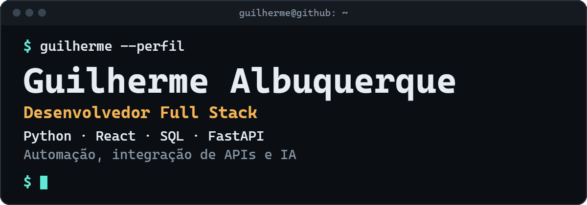
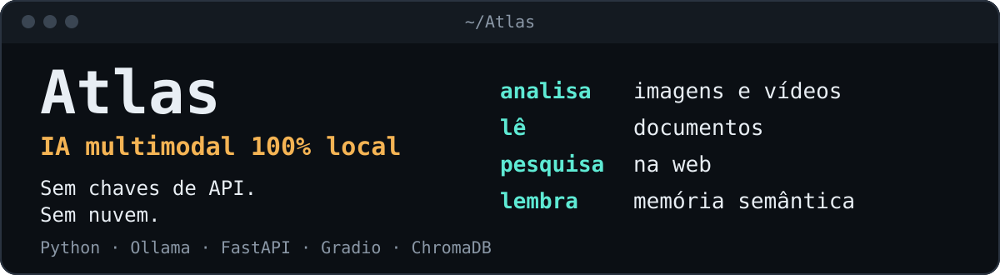
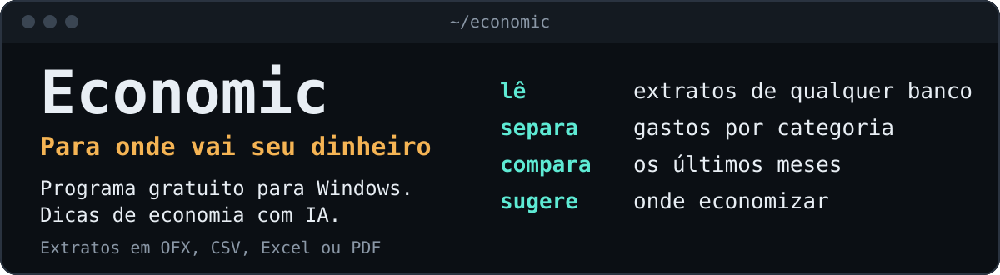
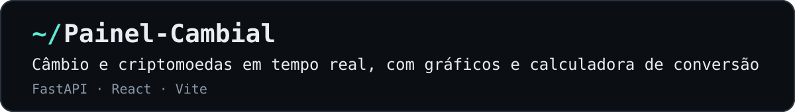
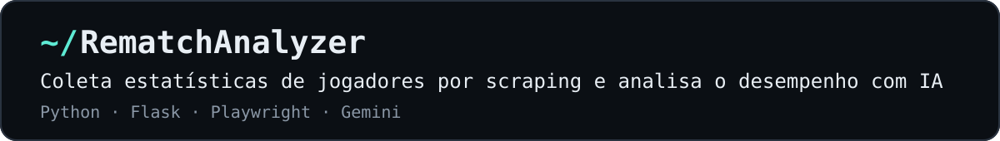
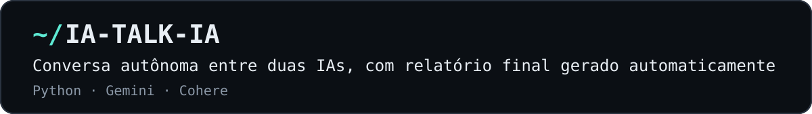

  

Crio sistemas internos, dashboards de análise de dados, automações e integrações com APIs REST. Também exploro IA generativa, LLMs, agentes de IA e servidores MCP.

## Projetos em destaque

  

  

  

  

  

## Experiência

**Queonetics** · Desenvolvedor de Produtos Internos | Suporte Técnico N2

Comecei no Suporte Técnico N2 e passei a desenvolver os produtos internos da empresa (código privado):

- **QueoDesk:** gestão de tickets integrada ao Jira, com KPIs personalizáveis e portal do cliente.
- **SynQ:** plataforma que unificou várias ferramentas de análise em um único dashboard, com busca de veículos e chat com IA.
- **SynQ Guardian:** visão panorâmica de toda a frota (em fase piloto).

## Tecnologias

**Linguagens e back-end**

**Front-end**

**Bancos de dados**

**IA, automação e ferramentas**

## Contato

